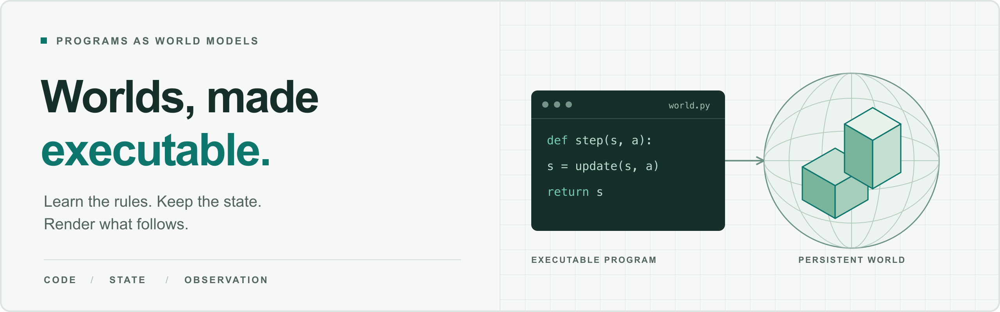

<div align="center">

# Code-Centric World Models

**Executable Dynamics · Persistent Worlds · Renderable Observations**

A living literature collection and home for our forthcoming survey.

**English** | [简体中文](README.zh-CN.md)

<!-- BADGES:BEGIN -->

[](https://github.com/sindresorhus/awesome) [](https://github.com/MichaelCao0/Awesome-Code-World-Model/stargazers) [](https://github.com/MichaelCao0/Awesome-Code-World-Model/network/members) [](CONTRIBUTING.md)

[](#paper-collection) [](#contents) [](docs/review-protocol.md)

 

<!-- BADGES:END -->

[📝 Survey Hub](docs/survey.md) · [📚 Paper Collection](#paper-collection) · [🧭 Taxonomy](docs/taxonomy.md) · [📖 BibTeX](papers.bib) · [🤝 Contributing](CONTRIBUTING.md)

<p></p>

</div>

<a id="motivation"></a>
## 💡 Motivation: Why Code, Why Now?

As coding agents become increasingly capable of **generating, executing, and refining complex programs**, code is emerging as a promising representation for world modeling.

Beyond predicting pixels, code-centric world models enable **explicit dynamics, persistent states, and programmable interactions**, offering a complementary path toward more **controllable, editable, and verifiable worlds**.

> [!NOTE]
> **📝 We are writing a survey on code-centric world models.** Explore the [survey hub](docs/survey.md) for our outline, framework, and bibliography.
>
> **🤝 PRs are welcome!** Help us add missing papers, correct metadata, refine the taxonomy, or improve the survey discussion. See the [contribution guide](CONTRIBUTING.md) to get started.

## News

- **2026-10-31 (reclassification)** — Split the three families by how much of the world code carries: WorldCoder-type (state only), Code-as-World-type (whitebox world + generative rendering), VibeWorlding-type (full 3D, static scenes included). Tightened Code-as-World-type, moved simulation-ready 3D construction to VibeWorlding-type, and grouped GUI world models as an unassigned GUI section. See the [update notes](docs/updates/2026-10-31.md#reclassification).
- **2026-10-31** — Added 21 records from the 2026-10-13–29 search pass, including executable dynamics, persistent world engines, editable 3D construction, and execution-grounded benchmarks. The strict catalogue boundary remains the three-family map; supporting sources stay unassigned.
- **2026-10-30** — Expanded the three-family assignments while leaving benchmarks and adjacent sources unassigned in the master list. The repository now has exactly three catalogue sections.
- **2026-10-29** — Added VibeWorlding, a 124-record [paper master list](docs/paper-master-list.md), and the initial three-family map: WorldCoder-type, Code-as-World-type, and VibeWorlding-type. Replaced the cover with a generated raster image.
- **2026-10-19** — Bilingual READMEs, a PNG cover, reserved survey links, and visual navigation.
- **2026-10-14** — Initial release: 92 source records, structured metadata, BibTeX, and a shared taxonomy and evaluation framework.

## Contents

[Motivation](#motivation) · [Survey & resources](#survey--resources) · [At a glance](#at-a-glance) · [Paper collection](#paper-collection) · [Contributing](#contributing) · [Acknowledgements](#acknowledgements)

**Writing discussion:** [Three-family map](docs/coarse-taxonomy.md) · [Paper master list](docs/paper-master-list.md) · [Classification JSON](data/classification.json) · [Update notes](docs/updates/2026-10-31.md)

<!-- NAVIGATION:BEGIN -->

| Three primary families |
|---|
| [01 · WorldCoder-type · Programmatic Dynamics](#papers-worldcoder) <sub>(38)</sub> |
| [02 · Code-as-World-type · Whitebox Worlds + Generative Rendering](#papers-code_as_world) <sub>(22)</sub> |
| [03 · VibeWorlding-type · Agentic 3D World Construction](#papers-vibeworlding) <sub>(35)</sub> |
| [Unassigned · GUI World Models](#papers-unassigned-gui) <sub>(16)</sub> |
| [Paper master list](docs/paper-master-list.md) (including unassigned sources) |

<!-- NAVIGATION:END -->

## Survey & resources

Our survey is **in preparation**. The [survey hub](docs/survey.md) brings together the current outline, conceptual framework, and bibliography, and will host the manuscript and accompanying materials when released.

| Read & explore | Write & contribute |
|---|---|
| [**Taxonomy & scope**](docs/taxonomy.md) — the semantic roles of code | [**Survey outline / 中文大纲**](docs/survey-outline.md) — research questions and chapters |
| [**Evaluation framework**](docs/evaluation.md) — from runtime correctness to agent utility | [**BibTeX bibliography**](papers.bib) — stable citation keys |
| [**Annotated catalogue**](docs/catalogue.md) — dates, scope, review depth, and evidence notes | [**Structured data**](data/papers.json) — source metadata and mechanism tags |

## At a glance

| Code carries… | What it enables | Start with |
|---|---|---|
| **Transitions & mechanisms** | Execute rules, predict consequences, and plan | [WorldCoder](https://arxiv.org/abs/2402.12275), [OneLife](https://arxiv.org/abs/2510.12088), [General Game Playing](https://arxiv.org/abs/2510.04542) |
| **Observations & appearance** | Predict a screen or scene as renderable code | [gWorld](https://arxiv.org/abs/2602.01576), [Code2World](https://arxiv.org/abs/2602.09856), [AppDeltaWorld](https://arxiv.org/abs/2608.05891) |
| **Execution + observation** | Maintain world state and connect it to visual output | [Web World Models](https://arxiv.org/abs/2512.23676), [Programmable World Model](https://arxiv.org/abs/2609.10540), [Magpie](https://arxiv.org/abs/2608.27168) |

Program origin, verification, and downstream use form a second set of attributes. The [taxonomy](docs/taxonomy.md) explains how they connect across branches.

### Three-family writing map

| Family (code carries…) | Core question | Representative anchors |
|---|---|---|
| **WorldCoder-type** · Programmatic Dynamics (state only) | Does code predict action consequences and support planning? | [WorldCoder](https://arxiv.org/abs/2402.12275), [TheoryCoder](https://arxiv.org/abs/2503.20124), [OneLife](https://arxiv.org/abs/2510.12088), [Code World Models for General Game Playing](https://arxiv.org/abs/2510.04542) |
| **Code-as-World-type** · Whitebox Worlds + Generative Rendering | Can executable state and rules over a whitebox/proxy world drive a generatively rendered world? | [Code World Model](https://arxiv.org/abs/2608.25927), [Programmable World Model](https://arxiv.org/abs/2609.10540), [AgentGarten](https://arxiv.org/abs/2610.12374), [Oneira](https://arxiv.org/abs/2610.01614) |
| **VibeWorlding-type** · Agentic 3D World Construction | Can an agent write and edit a full 3D world in code, static or simulation-ready? | [VibeWorlding](https://arxiv.org/abs/2608.15265), [WorldClaw](https://arxiv.org/abs/2608.05248), [USDCraft](https://arxiv.org/abs/2610.11322), [SceneRig](https://arxiv.org/abs/2610.28585) |

The families are split by how much of the world code carries: state only, a whitebox world rendered generatively, or the full 3D world. The [three-family guide](docs/coarse-taxonomy.md) gives the placement rules. GUI world models are listed in a separate [unassigned GUI group](#papers-unassigned-gui); benchmarks and adjacent records stay unassigned in the [master list](docs/paper-master-list.md).

<a id="paper-collection"></a>
## Paper collection

<!-- CATALOG:BEGIN -->

**132 sources** · literature through **2026-10-29**.

The README groups papers by the three primary families; smaller, benchmark, and adjacent sources remain in the [paper master list](docs/paper-master-list.md).

Each primary family is ordered by recorded publication date; the annotated catalogue and master list retain the complete corpus.

<a id="papers-worldcoder"></a>
### 01 · WorldCoder-type · Programmatic Dynamics

*State-level executable dynamics: transition mechanisms, world-program induction, planning, and model repair, without generated appearance.*

- **Algebraic World Model: From Exploration to Proofs** `2026` [](https://arxiv.org/abs/2610.40503)
  <br><sub>Explores unknown games with executable Python hypotheses, typed rules, and Lean formalization for reachability and impossibility proofs.</sub>

- **PhysEvolve: Verifier-grounded Self-evolution for Physical Reasoning with Executable Worlds** `2026` [](https://arxiv.org/abs/2610.34921)
  <br><sub>Has a shared VLM propose executable physical worlds while a deterministic engine verifies counterfactual branches and produces answer-bound training tasks.</sub>

- **Build, Don't Play: Self-Improving LLM Research Agents Develop a Hearthstone Battlegrounds AI That Rivals Top Players (AutoTavern)** `2026` [](https://arxiv.org/abs/2610.33845)
  <br><sub>A self-improving research-agent system builds and verifies a faithful Hearthstone Battlegrounds simulator, then trains agents against calibrated opponents.</sub>

- **LLM Agents as Suppliers of Physical System Models: Calibration and Acceptance in Modelica** `2026` [](https://arxiv.org/abs/2610.25019)
  <br><sub>Studies LLM coding agents that assemble and calibrate executable Modelica physical-system models from descriptions and data, with acceptance based on behavioral fit, invariants and interpretability.</sub>

- **Neurosymbolic Learning of Interpretable World Models (CGWM)** `2026` [](https://arxiv.org/abs/2610.19955)
  <br><sub>Learns visual concept grounding while a parameter-free predictor applies supplied temporal-logic transition rules; planning differentiates through symbolic imagined trajectories.</sub>

- **A Declared World Model: Language Models Write the Rules of the Scene They are Shown** `2026` [](https://www.preprints.org/manuscript/202610.1139)
  <br><sub>A language model writes world rules from a labelled scene graph. A deterministic engine checks proposed actions and computes next states. Experiments test whether generated rules transfer beyond the observed layout.</sub>

- **Write Once, Plan Many: Building Reusable Visual Planning Systems from One Scene** `2026` [](https://arxiv.org/abs/2610.19234)
  <br><sub>Builds reusable executable renderers, dynamics, perception and planning programs from supplied domain rules and one practice scene; execution and reconstruction checks refine programs before reuse.</sub>

- **RoleWorld: Knowledge Transfer in World Modeling with Functional Role Abstractions** `2026` [](https://arxiv.org/abs/2610.13172)
  <br><sub>Extracts reusable role prototypes and executable transition rules, then adapts role assignments and parameter estimates in new environments while keeping transition rules fixed.</sub>

- **Memento 3: Model-Based Recursive Self-Improvement through Reflective Rulebooks** `2026` [](https://arxiv.org/abs/2610.11794)
  <br><sub>Memento 3 revises reflective rulebooks and executable models using trajectory judgments and exact replay.</sub>

- **LLM-IDEA: Identifiability-Driven Experimental Agent for Autonomous Discovery of Mechanistic World Models** `2026` [](https://arxiv.org/abs/2610.11253)
  <br><sub>LLM-IDEA uses identifiability-aware experimental design to distinguish mechanistic explanations.</sub>

- **Kepler: Auditable World Models for ARC-AGI-3** `2026` [](https://arxiv.org/abs/2610.00834)
  <br><sub>Kepler studies auditable ARC-AGI-3 world models through retrospective and conditional transition checks and cost accounting.</sub>

- **EMPIRIC: Experiment-Driven Learning of Residual World Models for Robot Planning** `2026` [](https://arxiv.org/abs/2609.35047)
  <br><sub>EMPIRIC learns residual code that extends a physics engine with missing forces, constraints, and hidden state.</sub>

- **Code as Worlds: Agentic Discovery of Executable World Representations for Physical Reasoning** `2026` [](https://arxiv.org/abs/2608.27549)
  <br><sub>Code as Worlds discovers executable physical representations through propose, instantiate, execute, render, and verify loops.</sub>

- **Twin: Playing an Unknown Game with a Test-Time Digital Twin** `2026` [](https://arxiv.org/abs/2608.14490)
  <br><sub>Twin builds a test-time digital twin and checks historical transitions before choosing actions in unknown games.</sub>

- **Tycho: Active Abstraction with Programmatic World Models for ARC-AGI-3** `2026` [](https://arxiv.org/abs/2607.28287)
  <br><sub>Tycho actively revises abstractions and programmatic hypotheses while solving ARC-AGI-3 games.</sub>

- **VisualPatchWorld: Code World Models as Latent Structured Representations for Planning** `2026` [](https://arxiv.org/abs/2607.25236)
  <br><sub>VisualPatchWorld fits dynamics from structured state-action traces and uses visual scene graphs for replanning.</sub>

- **Program Synthesis for Simulation-Based Inference: Joint Model Selection and Parameter Estimation** `2026` [](https://arxiv.org/abs/2607.17540)
  <br><sub>Combines LLM-generated simulator families with neural simulation-based inference to select mechanisms and estimate parameters.</sub>

- **Do Coding Agents Need Executable World Models, Simplification, and Verification to Solve ARC-AGI-3?** `2026` [](https://arxiv.org/abs/2607.15439)
  <br><sub>Tests executable-model discipline, simplification, and replay verification in coding agents for ARC-AGI-3.</sub>

- **World-Time Compute with Verified Code World Models** `2026` [](https://arxiv.org/abs/2609.09163)
  <br><sub>World-Time Compute uses verified symbolic code worlds to generate exactly labeled trajectories for model training.</sub>

- **OPINE-World: Programmatic World Modeling with Ontology-error-Prioritized Interactive Exploration for ARC-AGI-3** `2026` [](https://arxiv.org/abs/2607.01531)
  <br><sub>OPINE-World jointly revises symbolic ontology, transition hypotheses, and goals through error-prioritized exploration.</sub>

- **Mind-Studio: Executable World Models with Lookahead Evaluation for Partially Observable Games** `2026` [](https://arxiv.org/abs/2606.16070)
  <br><sub>Mind-Studio constructs executable models for partially observable games and evaluates same-state multi-step lookahead fidelity.</sub>

- **PatchWorld: Gradient-Free Optimization of Executable World Models for Agent Environments** `2026` [](https://arxiv.org/abs/2605.30880)
  <br><sub>PatchWorld optimizes executable belief-state models through counterexample-guided patches and uses them for action lookahead.</sub>

- **Baba in Wonderland: Online Self-Supervised Dynamics Discovery for Executable World Models (Alice / Baba in Wonderland)** `2026` [](https://arxiv.org/abs/2605.16725)
  <br><sub>Alice learns executable dynamics under misaligned lexical priors, using preservation conflicts to revise hypotheses and guide exploration.</sub>

- **Executable World Models for ARC-AGI-3 in the Era of Coding Agents** `2026` [](https://arxiv.org/abs/2605.05138)
  <br><sub>Builds executable ARC-AGI-3 models with history replay, simplification, and planning.</sub>

- **Learning Abstractions for Hierarchical Planning in Program-Synthesis Agents (TheoryCoder-2)** `2026` [](https://arxiv.org/abs/2602.00929)
  <br><sub>TheoryCoder-2 learns and reuses planning abstractions in program-synthesis agents.</sub>

- **Agent2World: Learning to Generate Symbolic World Models via Adaptive Multi-Agent Feedback** `2025` [](https://arxiv.org/abs/2512.22336)
  <br><sub>Agent2World uses research, development, and adaptive testing agents to generate symbolic world models and training trajectories.</sub>

- **One Life to Learn: Inferring Symbolic World Models for Stochastic Environments from Unguided Exploration (OneLife)** `2025` [](https://arxiv.org/abs/2510.12088)
  <br><sub>OneLife learns conditionally activated probabilistic laws from unguided exploration in Crafter-OO.</sub>

- **Code World Models for General Game Playing** `2025` [](https://arxiv.org/abs/2510.04542)
  <br><sub>Synthesizes Python transitions, legal moves, termination, value heuristics, and hidden-state inference for board and card games.</sub>

- **Finite Automata Extraction: Low-data World Model Learning as Programs from Gameplay Video (FAE)** `2025` [](https://arxiv.org/abs/2508.11836)
  <br><sub>FAE extracts sprite-grid behavior programs from gameplay video through a constrained reactive DSL.</sub>

- **PoE-World: Compositional World Modeling with Products of Programmatic Experts** `2025` [](https://arxiv.org/abs/2505.10819)
  <br><sub>PoE-World composes programmatic experts into a stochastic world model for prediction and planning.</sub>

- **Synthesizing world models for bilevel planning (TheoryCoder)** `2025` [](https://arxiv.org/abs/2503.20124)
  <br><sub>TheoryCoder combines synthesized low-level Python dynamics with supplied high-level PDDL abstractions for bilevel planning.</sub>

- **Generating Symbolic World Models via Test-time Scaling of Large Language Models** `2025` [](https://arxiv.org/abs/2502.04728)
  <br><sub>Generates and corrects PDDL world models with Best-of-N search and fine-grained verbalized feedback.</sub>

- **Generating Code World Models with Large Language Models Guided by Monte Carlo Tree Search (GIF-MCTS)** `2024` [](https://arxiv.org/abs/2405.15383)
  <br><sub>GIF-MCTS searches executable Python world models using descriptions, offline transitions, and execution feedback.</sub>

- **WorldCoder, a Model-Based LLM Agent: Building World Models by Writing Code and Interacting with the Environment** `2024` [](https://arxiv.org/abs/2402.12275)
  <br><sub>WorldCoder synthesizes Python transition and reward models from interaction, coupling model consistency with optimistic planning.</sub>

- **Leveraging Pre-trained Large Language Models to Construct and Utilize World Models for Model-based Task Planning** `2023` [](https://arxiv.org/abs/2305.14909)
  <br><sub>Uses LLMs to construct and correct PDDL domain models for sound model-based task planning.</sub>

- **Combining Functional and Automata Synthesis to Discover Causal Reactive Programs (AutumnSynth)** `2023` [](https://doi.org/10.1145/3571249)
  <br><sub>AutumnSynth alternates transition-function synthesis and automata synthesis to recover reactive programs with latent state.</sub>

- **Human-Level Reinforcement Learning through Theory-Based Modeling, Exploration, and Planning (EMPA)** `2021` [](https://arxiv.org/abs/2107.12544)
  <br><sub>EMPA learns probabilistic game-engine programs and runs internal simulations for exploration and planning.</sub>

- **Game Engine Learning from Video** `2017` [](https://www.ijcai.org/proceedings/2017/518)
  <br><sub>Learns executable game-engine rules from video and evaluates future-state prediction and agent training.</sub>

[↑ Contents](#contents)

<a id="papers-code_as_world"></a>
### 02 · Code-as-World-type · Whitebox Worlds + Generative Rendering

*Code keeps persistent state and rules over a whitebox/proxy world; a generative renderer supplies appearance.*

- **Fight World Model: Customizable Combat through Visual Interaction Proxies** `2026` [](https://arxiv.org/abs/2610.40607)
  <br><sub>Separates executable combat state and rule resolution from video rendering with identity- and timing-aligned interaction proxies; tests rule changes and customization.</sub>

- **Wizard: Manipulate Any World in Real Time via Agentic Control** `2026` [](https://arxiv.org/abs/2610.40339)
  <br><sub>Combines structured skeleton/geometry proxies with an agentic framework that maintains game state for real-time, generalizable video-world control.</sub>

- **EdenLive: Real-Time Generative Rendering from Any Visual Reference** `2026` [](https://github.com/VAST-AI-Research/EdenLive)
  <br><sub>A generative renderer maps upstream reference video, a target first frame and a prompt to enhanced video. The upstream program maintains state and rules. Released tooling also includes a prompt-to-playable-game skill and workbench.</sub>

- **BoxWorld: Let World Engines Control and Video Generators Render** `2026` [](https://arxiv.org/abs/2610.36371)
  <br><sub>A coding agent turns user rules into a Box World Engine exposing persistent attributes and status variables; a state renderer converts the stream into interactive video.</sub>

- **Mundo: Customized World Model** `2026` [](https://mundo-world-model.github.io/)
  <br><sub>Images are reconstructed into an editable 3D proxy. A scene program specifies objects and physical parameters; scripts and usually MuJoCo evolve state. Proxy frames condition a video renderer together with context views.</sub>

- **AnyGameRenderer: Entity-Consistent Generative Rendering Across Games and an Entity-Level Benchmark** `2026` [](https://arxiv.org/abs/2610.31466)
  <br><sub>Renders agent-built game blockouts into entity-consistent video while preserving layout, camera, entity timing, and count changes.</sub>

- **SolarRenderer: Few-Step Generative Reference Rendering** `2026` [](https://arxiv.org/abs/2610.28630)
  <br><sub>Adapts a frozen video backbone with control and acceleration LoRAs to turn aligned structural video into detailed video, including streaming generation.</sub>

- **Matrix-Game 4.0: Harnessing Video Models for Real-Time Playable Game Worlds** `2026` [](https://arxiv.org/abs/2610.27999)
  <br><sub>A coding agent turns player requests into executable game rules; an engine owns persistent state, while a causal video model renders detailed views from low-poly proxies.</sub>

- **State World Models: Execute the Rules, Generate the Pixels** `2026` [](https://arxiv.org/abs/2610.26811)
  <br><sub>A coding agent writes a typed game definition; a runtime executes rules over semantic and spatial state before a frozen video renderer, then admits rule-compatible visual feedback.</sub>

- **Mallea: Building, Steering, and Memorizing Worlds with Coding Agent** `2026` [](https://arxiv.org/abs/2610.21283)
  <br><sub>A coding agent jointly builds object structures and rules, supports runtime edits preserving unaffected state, and combines executed state with object texture memory for rendering.</sub>

- **Any Time, Any Space: A World-State-Centric Framework for Agentic Video Generation (ATAS)** `2026` [](https://arxiv.org/abs/2610.20571)
  <br><sub>Compiles screenplay shots with spatial and event-time references, retrieves registered scene and event memories, and admits generated observations into memory only after checks.</sub>

- **Generative World Simulation with DAO and JING (DAO + JING)** `2026` [](https://arxiv.org/abs/2610.19726)
  <br><sub>DAO maintains shared character, object, and space states under world time and interaction rules, while JING renders observer-specific audiovisual experiences.</sub>

- **From Pixels to Executable Physics: Behavior-Grounded World Models for Embodied Action Consequence Prediction (DR-WM)** `2026` [](https://arxiv.org/abs/2610.17630)
  <br><sub>Combines RGB scene reconstruction and behavior-calibrated terrain contact priors with physics simulation, using simulated motion and geometry to guide a video world model.</sub>

- **StreamRender-H3: Interactive Coding Worlds with Real-time Streaming Diffusion Render** `2026` [](https://nvlabs.github.io/Sana/Sol-Engine/StreamRender-H3/)
  <br><sub>A three.js game engine maintains maps, rules and state, advancing on player inputs. Semantic frames connect it to a streaming MiniMax-H3 renderer. The demonstrated system separates executable simulation from generated appearance.</sub>

- **AgentGarten: Code Worlds for Evolving Agents** `2026` [](https://arxiv.org/abs/2610.12374)
  <br><sub>AgentGarten connects program-defined simulation backends to a shared real-time renderer and reusable agent playbooks.</sub>

- **Oneira: From Open-Ended Generation to Open-World Interaction in Video World Models** `2026` [](https://arxiv.org/abs/2610.01614)
  <br><sub>A coding agent and lightweight engine maintain an extensible world-state table, compile coarse visual conditions, and incorporate newly observed objects for persistent interaction.</sub>

- **Code Plans, Diffusion Renders: Open-Ended Generative World Modeling (CoDeR)** `2026` [](https://arxiv.org/abs/2609.26458)
  <br><sub>CoDeR coordinates executable whitebox world construction with a generative Artist for open-ended visual worlds.</sub>

- **GameDirector: Decoupling Gameplay Logic from Rendering for Player-Configurable Game World Models** `2026` [](https://arxiv.org/abs/2609.25652)
  <br><sub>GameDirector uses visual situation estimates and explicit gameplay rules to control game-video generation.</sub>

- **Programmable World Model** `2026` [](https://arxiv.org/abs/2609.10540)
  <br><sub>Programmable World Model compiles persistent engine state, including nonvisual facts, into controls for video generation.</sub>

- **Magpie: Real-Time World Renderer for Interactive Games** `2026` [](https://arxiv.org/abs/2608.27168)
  <br><sub>Magpie combines persistent game-engine state and rules with a whitebox-conditioned interactive neural renderer.</sub>

- **Code World Model: Coding Agent as World Brain** `2026` [](https://arxiv.org/abs/2608.25927)
  <br><sub>Code World Model separates a coding world brain from a visual world engine through executable proxy representations.</sub>

- **Web World Models** `2025` [](https://arxiv.org/abs/2512.23676)
  <br><sub>Web World Models uses typed web state and code-defined rules as the substrate for persistent, generative worlds.</sub>

[↑ Contents](#contents)

<a id="papers-vibeworlding"></a>
### 03 · VibeWorlding-type · Agentic 3D World Construction

*Code specifies the full 3D world (geometry, materials, layout, and optionally physics) for conventional rendering or simulation; static scenes included.*

- **Gym-Anything for Robotics: Scaling physical simulations with digital agents** `2026` [](https://arxiv.org/abs/2610.40565)
  <br><sub>Treats simulation creation as a coding-agent task and releases RoboWorld environments plus an adversarial creation-audit loop for physical simulation construction.</sub>

- **Cinematize from Unreal: Agentic Choreography for Controllable World Simulation (CineU)** `2026` [](https://arxiv.org/abs/2610.38468)
  <br><sub>Uses an Unreal project as a persistent inspectable world; agent-generated code performs geometry- and capability-constrained operations with verification and localized repair.</sub>

- **Learning to Code the World: Harness Evolution for Compositional 3D Reconstruction (SceneEvolve)** `2026` [](https://arxiv.org/abs/2610.37046)
  <br><sub>Represents compositional 3D scenes as executable code and evolves the reconstruction harness while fixing model parameters, action semantics, and execution backend.</sub>

- **SceneAgent: An Agentic Pipeline from 3D and 4D Captures to Simulation Environments** `2026` [](https://arxiv.org/abs/2610.34745)
  <br><sub>Coordinates reconstruction, physical modeling, simulation inspection, and repair to turn 3D/4D captures into interactive simulation environments.</sub>

- **SceneBloom: Agentic Indoor Environment Generation with Realistic and Diverse Layouts for Embodied Learning** `2026` [](https://arxiv.org/abs/2610.32978)
  <br><sub>Combines visual layout sampling with contract-guided 3D compilation and physical-stability checks for embodied-learning environments.</sub>

- **WorldMirror: Agentic Real-to-Sim Generation of Interactive Worlds from In-the-Wild Robot Demonstrations** `2026` [](https://arxiv.org/abs/2610.31834)
  <br><sub>Constructs interactive digital twins from in-the-wild robot demonstrations by iteratively refining an executable world program with verification feedback.</sub>

- **WorldStream: Streaming Interactive 3D Worlds with Hierarchical Planning and Persistent State** `2026` [](https://arxiv.org/abs/2610.28827)
  <br><sub>Hierarchical planning predicts typed regional and tile specifications; fixed procedural generators compile them, while persistent records retain identities, boundary contracts and edits across streaming revisits.</sub>

- **SceneRig: An Agentic System for Simulation-Ready 3D Scene Reconstruction from Single Images** `2026` [](https://arxiv.org/abs/2610.28585)
  <br><sub>Reconstructs objects and scene layout from one image, then edits scene code and uses bounded pose search plus simulation validation to retain physically stable, visually aligned configurations.</sub>

- **NeoWorld-3: From Pixels to Code-Defined Physical Worlds** `2026` [](https://arxiv.org/abs/2610.27690)
  <br><sub>Reconstructs editable geometry programs from visual evidence through hierarchical coding agents, differentiable parameter fitting and articulation/physics checks.</sub>

- **InfiniDream: Open-Ended Photorealistic 3D Worlds Through Procedural Generation** `2026` [](https://arxiv.org/abs/2610.26853)
  <br><sub>Uses a VLM-driven procedural pipeline with symbolic constraints and deterministic placement to build editable, animated, photorealistic 3D worlds.</sub>

- **Self-Building Labs** `2026` [](https://arxiv.org/abs/2610.23826)
  <br><sub>Agents construct laboratory digital twins, reusable robot skills and workflows from objectives, photographs and device information, refining scene models using observations and physical feedback.</sub>

- **3DCodeVerse: Exploring 3D Worlds as Code** `2026` [](https://arxiv.org/abs/2610.22341)
  <br><sub>Packages executable 3D programs with assets and verification records; a generation-and-repair harness uses execution, geometry measurements and visual feedback.</sub>

- **BlenderWorld: Benchmarking Visual Agents for 3D Creation from Real-World References** `2026` [](https://arxiv.org/abs/2610.23986)
  <br><sub>Evaluates agent-created Blender projects against multimodal briefs using rendered views, task rubrics and visual-quality judgments.</sub>

- **RoboSimStudio: An Interactive Toolkit for Human and Agent Rapid Real2Sim of Robot Manipulation Tasks** `2026` [](https://arxiv.org/abs/2610.18835)
  <br><sub>Interactive Newton-based toolkit exposes solver, contact-model and physical-parameter choices so humans and coding agents can refine manipulation simulations against observed behavior.</sub>

- **Code2Worlds-2: Physically Plausible Agent Harness for Embodied World Simulation** `2026` [](https://arxiv.org/abs/2610.17651)
  <br><sub>Compiles generated visual scenes into MuJoCo-compatible worlds with physical attributes and refines executable dynamics using simulator feedback.</sub>

- **ExeWorldBench: Benchmarking Code-Based Executable 3D World Modeling** `2026` [](https://arxiv.org/abs/2610.15166)
  <br><sub>Evaluates individual mechanisms, compositional mechanical systems, and intent-driven executable 3D world synthesis.</sub>

- **USDCraft: Geometrically Grounded Programmatic Modeling of Articulated 3D Assets for Simulation** `2026` [](https://arxiv.org/abs/2610.11322)
  <br><sub>USDCraft converts source geometry into executable modeling programs that export articulated USD simulation assets.</sub>

- **LEGO-Anything: Coding Agents for 3D Scene Reconstruction** `2026` [](https://arxiv.org/abs/2609.36380)
  <br><sub>LEGO-Anything reconstructs 3D scenes as executable programs and separates artifact, geometry, and appearance evaluation.</sub>

- **Recursive Code World Models: Building Complex Worlds through Recursive Scene Programs** `2026` [](https://arxiv.org/abs/2609.11499)
  <br><sub>Recursive Code World Models reconstruct complex scenes using recursive programs, global-local refinement, and shared reference views.</sub>

- **FuncRoom-Agent: Sequential Feed-Forward 3D Functional Indoor Scene Generation** `2026` [](https://arxiv.org/abs/2608.29519)
  <br><sub>FuncRoom-Agent generates functional indoor scenes with a recursive DSL, sequential expert, and execution-grounded process reward.</sub>

- **VibeWorlding: Can Multimodal Agents Construct 3D Open Worlds End-to-End?** `2026` [](https://arxiv.org/abs/2608.15265)
  <br><sub>VibeWorlding studies an end-to-end multimodal coding agent that constructs and edits open 3D worlds in a Blender sandbox through asset retrieval, procedural editing, rendered-view feedback, and physical-feasibility checks.</sub>

- **WorldClaw: Agentic 3D Open-World Generation at Scale** `2026` [](https://arxiv.org/abs/2608.05248)
  <br><sub>WorldClaw builds large editable 3D scenes through region planning, terrain generation, and render-guided refinement.</sub>

- **SceneCode: Executable World Programs for Editable Indoor Scenes with Articulated Objects** `2026` [](https://arxiv.org/abs/2605.19587)
  <br><sub>SceneCode builds editable indoor world programs with articulated objects, simulation exports, and persistent scene organization.</sub>

- **ChronoAgentic: A Code-based Multi-Agent World Simulator for Physically Grounded Simulation Construction** `2026` [](https://arxiv.org/abs/2605.14398)
  <br><sub>ChronoAgentic constructs PyChrono simulation programs using planning, coding, visual review, and trajectory checks.</sub>

- **Code2Worlds: Empowering Coding LLMs for 4D World Generation** `2026` [](https://arxiv.org/abs/2602.11757)
  <br><sub>Code2Worlds generates object and scene programs for 4D simulation, using Blender dynamics and visual motion feedback.</sub>

- **Procedural Scene Programs for Open-Universe Scene Generation: LLM-Free Error Correction via Program Search** `2025` [](https://arxiv.org/abs/2510.16147)
  <br><sub>Studies procedural scene programs and error correction through program search.</sub>

- **Imperative vs. Declarative Programming Paradigms for Open-Universe Scene Generation** `2025` [](https://arxiv.org/abs/2504.05482)
  <br><sub>Studies imperative and declarative scene-program representations and program-based error correction.</sub>

- **SceneMotifCoder: Example-driven Visual Program Learning for Generating 3D Object Arrangements** `2024` [](https://arxiv.org/abs/2408.02211)
  <br><sub>SceneMotifCoder learns editable object-arrangement programs from a few visual examples.</sub>

- **SceneCraft: An LLM Agent for Synthesizing 3D Scene as Blender Code** `2024` [](https://arxiv.org/abs/2403.01248)
  <br><sub>SceneCraft translates scene blueprints into Blender code and refines them with rendered visual feedback.</sub>

- **Open-Universe Indoor Scene Generation using LLM Program Synthesis and Uncurated Object Databases** `2024` [](https://arxiv.org/abs/2403.09675)
  <br><sub>Open-Universe Indoor Scene Generation synthesizes executable layout constraints over uncurated object databases.</sub>

- **Holodeck: Language Guided Generation of 3D Embodied AI Environments** `2023` [](https://arxiv.org/abs/2312.09067)
  <br><sub>Holodeck builds language-guided 3D embodied environments through spatial constraints and optimization.</sub>

- **Infinite Photorealistic Worlds Using Procedural Generation (Infinigen)** `2023` [](https://openaccess.thecvf.com/content/CVPR2023/html/Raistrick_Infinite_Photorealistic_Worlds_Using_Procedural_Generation_CVPR_2023_paper.html)
  <br><sub>Infinigen provides procedural rules for generating photorealistic geometry and materials at world scale.</sub>

- **ShapeAssembly: Learning to Generate Programs for 3D Shape Structure Synthesis** `2020` [](https://arxiv.org/abs/2009.08026)
  <br><sub>ShapeAssembly represents 3D part structure with hierarchical parametric assembly programs.</sub>

- **CSGNet: Neural Shape Parser for Constructive Solid Geometry** `2018` [](https://openaccess.thecvf.com/content_cvpr_2018/html/Sharma_CSGNet_Neural_Shape_CVPR_2018_paper.html)
  <br><sub>CSGNet parses visual shapes into executable constructive-solid-geometry programs.</sub>

- **Procedural content generation for games** `2013` [](https://doi.org/10.1145/2422956.2422957)
  <br><sub>Historical reference on procedural content generation for games; bibliographic metadata reviewed.</sub>

[↑ Contents](#contents)

<a id="papers-unassigned-gui"></a>
### Unassigned · GUI World Models

*GUI, web, and computer-use world models, including renderable-code screen predictors. Not yet included in the three families.*

<details>
<summary>16 records</summary>

- **Agent World Model in the Wild: Computer-Use Agent Environment Synthesis (WildAWM)** `2026` [](https://arxiv.org/abs/2610.26828)
  <br><sub>Synthesizes executable computer-use worlds spanning GUI, MCP and CLI interfaces, with replayable state-building programs and execution-based task/verifier quality gates for agent training.</sub>

- **Beyond Next-Screen Prediction: The Decision Value of GUI World Models** `2026` [](https://arxiv.org/abs/2610.24372)
  <br><sub>Controls prediction presentation and supervision when comparing GUI lookahead with a directly learned action ranker, testing the incremental decision value of predicted screens.</sub>

- **Right Screen, Wrong Transition: World Models as Verifiers for GUI Agents** `2026` [](https://arxiv.org/abs/2610.11942)
  <br><sub>Studies GUI world models as transition verifiers and separates screen similarity from transition correctness.</sub>

- **AutoGUIWorld: Image Generators as Visual World Models for GUI Agent** `2026` [](https://arxiv.org/abs/2610.01215)
  <br><sub>AutoGUIWorld synthesizes GUI trajectories by planning visual consequences and iteratively editing screenshots.</sub>

- **The GUI Is Not the State: Diagnosing State Aliasing in GUI World Models (StateAliasBench)** `2026` [](https://arxiv.org/abs/2609.32679)
  <br><sub>StateAliasBench pairs identical visible GUI conditions with different futures to diagnose hidden transition state.</sub>

- **WebWorld: The Browser as a World Model for Self-Improving Web Code** `2026` [](https://arxiv.org/abs/2608.30530)
  <br><sub>Uses the browser to execute and verify self-improving web code against interaction contracts and preserved behaviors.</sub>

- **GUI-CC: Benchmarking Contextual Consistency of GUI World Models as Agent Environments** `2026` [](https://arxiv.org/abs/2609.00048)
  <br><sub>GUI-CC evaluates multi-step contextual consistency through offline reference actions and online agent loops.</sub>

- **AppDeltaWorld: Transition-Grounded Delta Code World Model for Mobile GUI Agents** `2026` [](https://arxiv.org/abs/2608.05891)
  <br><sub>AppDeltaWorld predicts transition-grounded HTML updates with retrieved structure, visual assets, and closed-loop refinement.</sub>

- **OpenComputer: Verifiable Software Worlds for Computer-Use Agents** `2026` [](https://arxiv.org/abs/2605.19769)
  <br><sub>OpenComputer provides real software environments with structured state verification and auditable task rewards.</sub>

- **How Mobile World Model Guides GUI Agents?** `2026` [](https://arxiv.org/abs/2605.10347)
  <br><sub>Compares text, image, and renderable-code mobile predictions across reconstruction, online use, and agent-consumption strategies.</sub>

- **Computer-Using World Model** `2026` [](https://arxiv.org/abs/2602.17365)
  <br><sub>Computer-Using World Model predicts textual changes and then screenshots for desktop software interactions.</sub>

- **WebWorld: A Large-Scale World Model for Web Agent Training** `2026` [](https://arxiv.org/abs/2602.14721)
  <br><sub>WebWorld learns a large-scale web simulator for agent training.</sub>

- **Code2World: A GUI World Model via Renderable Code Generation** `2026` [](https://arxiv.org/abs/2602.09856)
  <br><sub>Code2World learns next-GUI code generation with AndroidCode, visual revision, and render-aware learning.</sub>

- **Generative Visual Code Mobile World Models (gWorld)** `2026` [](https://arxiv.org/abs/2602.01576)
  <br><sub>gWorld predicts mobile GUI observations as renderable web code with a single vision-language model.</sub>

- **MobileWorldBench: Towards Semantic World Modeling For Mobile Agents** `2025` [](https://arxiv.org/abs/2512.14014)
  <br><sub>MobileWorldBench evaluates semantic mobile state transitions and their usefulness for GUI agents.</sub>

- **ViMo: A Generative Visual GUI World Model for App Agents** `2025` [](https://arxiv.org/abs/2504.13936)
  <br><sub>ViMo models mobile GUI futures through graphic and textual decomposition.</sub>

</details>

[↑ Contents](#contents)

<!-- CATALOG:END -->

## Contributing

Papers, corrections, and useful comparisons are welcome. See the [contribution guide](CONTRIBUTING.md) for source verification and classification conventions, or [open an issue](https://github.com/MichaelCao0/Code-world-survey/issues/new).

The collection is generated from [data/papers.json](data/papers.json). To update it locally:

```bash
python3 scripts/build_catalog.py
python3 scripts/build_catalog.py --check
```

<details>
<summary><strong>Source policy & naming guide</strong></summary>

Records link to primary arXiv, DOI, or official proceedings pages. Paper titles and method aliases are stored separately. Dates follow the source metadata; conference years may differ. Review depth and paper-specific experimental conditions are available in the [annotated catalogue](docs/catalogue.md) and [review protocol](docs/review-protocol.md).

| Similar names | Distinction |
|---|---|
| Code2World / Code2Worlds | GUI observation prediction / 4D simulation generation |
| Web World Models / WebWorld | Code-defined persistent worlds / learned web simulation / browser-based code verification; three separate sources |
| WorldCoder / WorldCoder-Bench | Model-based agent / 3D world-synthesis benchmark |
| TheoryCoder / TheoryCoder-2 | Method aliases; their exact publication titles are retained in the bibliography |
| OneLife / General Game Playing | Stochastic dynamics from exploration / executable models from game rules and trajectories |
| FAIR CWM | Neural modeling of computational execution and code generation |

Related preprints are linked in the structured data. Counts describe bibliographic source records, with core methods, historical lineage, enabling representations, benchmarks, and comparators labeled in the annotated catalogue.

</details>

## Acknowledgements

The presentation takes inspiration from [Awesome World Models](https://github.com/knightnemo/Awesome-World-Models). The cover illustration is original to this repository. We thank the authors whose papers and public resources make this collection possible.

<p align="center"><a href="#code-centric-world-models">Back to top ↑</a></p>
