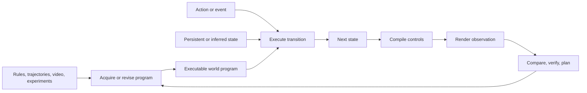

# Taxonomy and scope

Code-centric world modeling makes world facts executable, editable, and inspectable. The useful organizing question is which part of the world model a program represents: its transitions, its observations, or a connection between both.

## Three semantic roles

| Role | Operational question | Typical representation | Examples |
|---|---|---|---|
| Transition / mechanism | Can the program advance a modeled state under an action or event? | Python transition functions, PDDL operators, probabilistic laws, reactive programs, physics-engine extensions | WorldCoder, OneLife, TheoryCoder, EMPIRIC |
| Observation / appearance | Can executing the program produce the modeled observation or scene? | HTML, scene programs, Blender code, geometric proxies | gWorld, Code2World, SceneCraft |
| Coupled transition and observation | How does persistent executed state constrain future observations? | Executable engine plus state compiler, whitebox renderer, browser interface, neural visual engine | Web World Models, Programmable World Model, CoDeR, Magpie |

The catalogue stores `code_roles` as a subset of `transition` and `observation`. Both values indicate coupled responsibility. A paper may have several modules with different responsibilities; its tags describe the composition. An empty value is appropriate for bibliographic context or a comparator whose dynamics are learned directly by a neural model.

For transition programs, a schematic runtime is

$$s_{t+1} = \operatorname{Exec}(P, s_t, a_t, \xi_t),$$

where the random variable $\xi_t$ accommodates stochastic mechanisms. A program can therefore be executable and probabilistic at the same time. The maintained state can also be a belief or predictive state $b_t$ inferred from history.

When execution and visual generation are coupled,

$$c_{t+1}=\operatorname{Compile}(s_{t+1}),\qquad o_{t+1}=\operatorname{Render}(c_{t+1},h_t).$$

Here, $c$ can be a geometric proxy, typed controls, bounding boxes, or a textual situation description. The renderer may be conventional, browser-based, or neural. A next-screen code predictor instead produces observation code from history and an action, then renders that code; transition semantics may reside in the predicting model.

This diagram depicts a common composition. The lifecycle tags identify which stages a particular work implements.

## Task roles determine the reference for correctness

| Task role | What is being modeled or built? | Reference for evaluation |
|---|---|---|
| Predictive model of a target world | Approximate an existing environment's transition and observation behavior | Held-out transitions, counterfactual probes, trajectories, and real interaction |
| Constructed executable world | Define a new environment from a specification or design | Specification, behavior contracts, consistency, and interaction tests |
| Observation predictor | Predict the visible result of an action | Reference screens, contextual rollout consistency, hidden-state diagnostics, and agent utility |

WorldCoder and PatchWorld model target environments; Web World Models defines persistent code-backed environments; gWorld and Code2World predict observations. Code as Worlds and Video2World connect reconstruction to executable physical worlds. These roles can coexist within a system, but they place different demands on evidence.

## State ownership, estimation, and rule origin

State ownership describes which component supplies the runtime state used by a system. State estimation describes how well that state captures the target environment. Rule origin describes how its transitions were obtained. Recording these attributes separately clarifies several comparisons:

- Programmable World Model maintains engine state and compiles it into visual controls.
- PatchWorld maintains an inferred belief-state program whose predictions are checked against external transitions.
- MASS maintains authoritative shared state while learning its Logic Engine.
- Magpie uses game-engine rules and persistent state with a neural renderer.

These designs have different learning targets and verification interfaces even when all maintain state across time.

## Lifecycle and use are orthogonal tags

| Dimension | Useful attributes |
|---|---|
| Program origin | Human or engine supplied; specification synthesized; interaction induced; video reconstructed; residual extension |
| Representation learning | Object abstraction; ontology revision; latent-state discovery; program-library learning |
| Verification and maintenance | Execution tests; history replay; counterexample repair; preservation constraints; render comparison; active experiment |
| Use | Planning; lookahead; training-data generation; environment construction; visual control; agent evaluation |

A program learned from video and used for planning belongs to one semantic category while carrying several lifecycle tags. PDDL and Python therefore share a transition-modeling branch; their representation, feedback, and planner interfaces provide the comparison dimensions.

## Reading sections and scope labels

README sections are editorial routes through the literature. Persistent world construction and visual coupling both commonly use transition and observation programs, while their principal research questions differ. Benchmarks and historical foundations have separate sections because of their role in the survey argument.

`scope` labels identify how each source contributes:

- **core:** a direct code-centric world-model mechanism.
- **historical:** earlier executable dynamics, rule inference, or planning-domain work.
- **enabling:** scene, asset, inverse-graphics, or program-learning representation.
- **benchmark / resource:** evaluation protocol or executable environment substrate.
- **comparator:** a method that tests a relevant alternative representation, state architecture, or use case.
- **adjacent:** a related mechanism or application that informs a boundary or design choice.
- **survey:** a neighboring literature synthesis.

Static scene and asset programs provide enabling representations. Claims about interactive behavior need corresponding transition, articulation, or simulation evidence. Similarly, computational execution modeling in FAIR CWM informs the code-as-object comparison, while external world programs supply a different modeling interface.

## What the survey can contribute

The strongest survey contribution is a connected account of **program responsibility → program acquisition and revision → evidence → agent use**. This lens explains why renderable-code GUI predictors, inferred Python simulators, PDDL planning models, and engine-controlled video generators share useful ideas while requiring different tests. It also makes new literature easy to place without creating a new taxonomy branch for every method.
